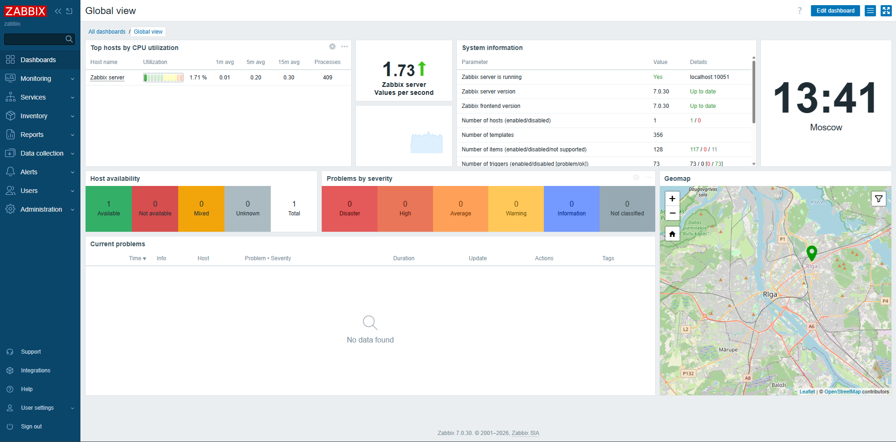
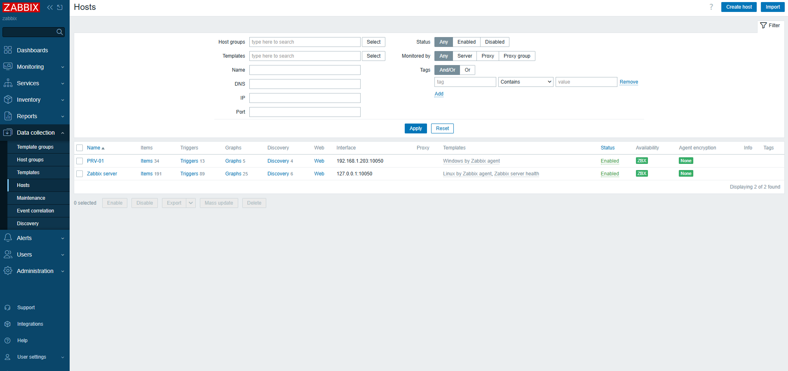
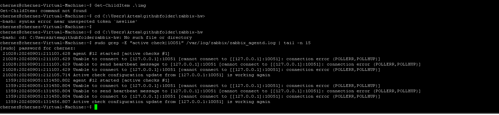
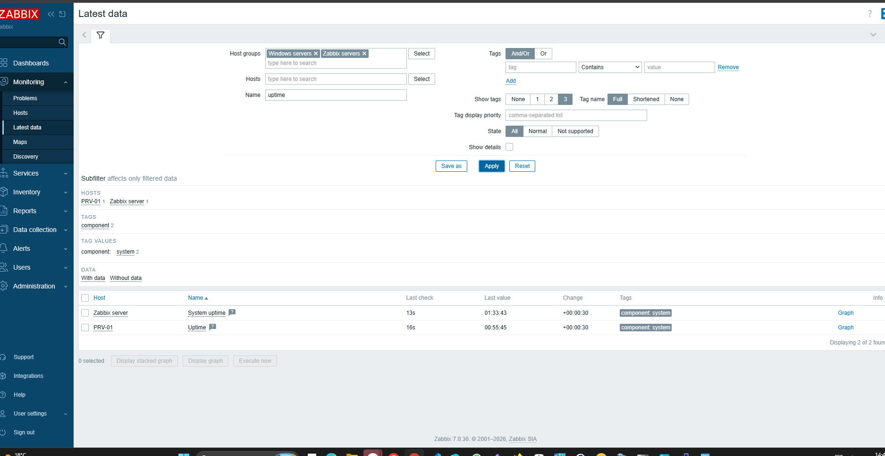
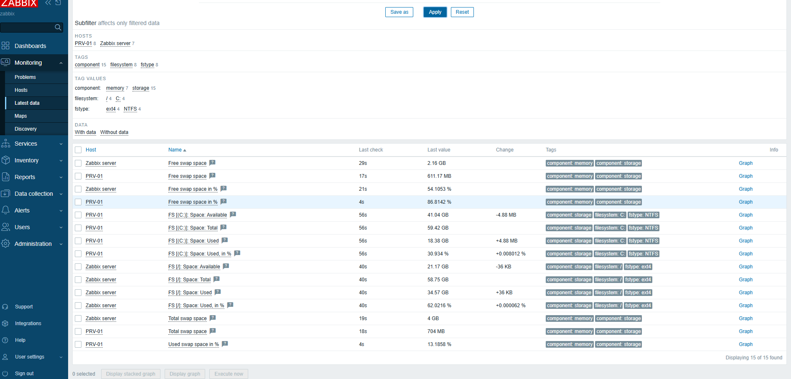

# Домашнее задание к занятию «Система мониторинга Zabbix»

**Выполнил:** Чернецов Артемий

---

## Задание 1. Установка Zabbix Server с веб-интерфейсом

Для выполнения задания использовалась виртуальная машина:

- Ubuntu 24.04.3 LTS
- PostgreSQL 16
- Apache
- Zabbix 7.0 LTS
- IP-адрес сервера: `192.168.1.13`

### 1. Обновление списка пакетов

```bash
sudo apt update
```

### 2. Установка PostgreSQL

```bash
sudo apt install postgresql -y
```

Проверка состояния PostgreSQL:

```bash
systemctl status postgresql --no-pager
```

PostgreSQL был успешно установлен и запущен.

### 3. Создание пользователя и базы данных Zabbix

Создан пользователь PostgreSQL `zabbix`:

```bash
sudo -u postgres createuser --pwprompt zabbix
```

Создана база данных `zabbix`, владельцем которой является пользователь `zabbix`:

```bash
sudo -u postgres createdb -O zabbix zabbix
```

Проверка созданной роли:

```bash
sudo -u postgres psql -c "\du"
```

Проверка базы данных:

```bash
sudo -u postgres psql -c "\l"
```

В результате была создана база данных `zabbix` с владельцем `zabbix`.

### 4. Подключение официального репозитория Zabbix 7.0

Скачан пакет официального репозитория Zabbix для Ubuntu 24.04:

```bash
wget https://repo.zabbix.com/zabbix/7.0/ubuntu/pool/main/z/zabbix-release/zabbix-release_latest+ubuntu24.04_all.deb
```

Установлен пакет репозитория:

```bash
sudo dpkg -i zabbix-release_latest+ubuntu24.04_all.deb
```

Обновлён список пакетов:

```bash
sudo apt update
```

Проверена доступная версия Zabbix Server:

```bash
apt-cache policy zabbix-server-pgsql
```

Для установки была доступна версия Zabbix `7.0.30`.

### 5. Установка Zabbix Server и веб-интерфейса

Установлены Zabbix Server с поддержкой PostgreSQL, веб-интерфейс, конфигурация Apache, SQL-скрипты и Zabbix Agent:

```bash
sudo apt install zabbix-server-pgsql zabbix-frontend-php php8.3-pgsql zabbix-apache-conf zabbix-sql-scripts zabbix-agent -y
```

Проверка установленных компонентов:

```bash
dpkg -l | grep zabbix
```

Были установлены следующие основные пакеты:

- `zabbix-server-pgsql`
- `zabbix-frontend-php`
- `zabbix-apache-conf`
- `zabbix-sql-scripts`
- `zabbix-agent`

### 6. Импорт начальной схемы базы данных Zabbix

В созданную базу данных была импортирована начальная схема Zabbix:

```bash
zcat /usr/share/zabbix-sql-scripts/postgresql/server.sql.gz | psql -U zabbix -d zabbix -h localhost
```

После импорта выполнена проверка количества таблиц:

```bash
sudo -u postgres psql -d zabbix -tAc "SELECT count(*) FROM pg_tables WHERE schemaname='public';"
```

Результат:

```text
203
```

Таким образом, схема базы данных Zabbix была успешно импортирована.

### 7. Настройка подключения Zabbix Server к PostgreSQL

Открыт конфигурационный файл сервера:

```bash
sudo nano /etc/zabbix/zabbix_server.conf
```

В конфигурации были заданы параметры подключения к базе данных:

```ini
DBName=zabbix
DBUser=zabbix
DBPassword=<пароль пользователя PostgreSQL zabbix>
```

После изменения конфигурации Zabbix Server был перезапущен и добавлен в автозагрузку:

```bash
sudo systemctl restart zabbix-server
sudo systemctl enable zabbix-server
```

Проверка состояния сервиса:

```bash
systemctl status zabbix-server --no-pager
```

Результат:

```text
Active: active (running)
```

Zabbix Server успешно запущен.

### 8. Настройка веб-интерфейса

Apache был перезапущен и добавлен в автозагрузку:

```bash
sudo systemctl restart apache2
sudo systemctl enable apache2
```

Веб-интерфейс Zabbix был открыт по адресу:

```text
http://192.168.1.13/zabbix
```

В мастере установки были использованы следующие параметры подключения к базе данных:

```text
Database type: PostgreSQL
Database host: localhost
Database port: 0
Database name: zabbix
User: zabbix
```

После завершения настройки выполнен вход в административный интерфейс Zabbix.

### Результат задания 1

Zabbix Server успешно установлен и запущен. Веб-интерфейс доступен, соединение с PostgreSQL работает.

На Dashboard отображается:

```text
Zabbix server is running: Yes
Zabbix server version: 7.0.30
Zabbix frontend version: 7.0.30
```

Скриншот успешной авторизации в административном веб-интерфейсе Zabbix:



---

## Задание 2. Установка Zabbix Agent на два хоста

Для мониторинга были настроены два хоста:

1. `Zabbix server` — Ubuntu 24.04.3 LTS, на котором одновременно работают Zabbix Server и Zabbix Agent.
2. `PRV-01` — виртуальная машина Windows 10 с установленным Zabbix Agent.

### 1. Zabbix Agent на сервере Ubuntu

Zabbix Agent был установлен вместе с компонентами Zabbix:

```bash
sudo apt install zabbix-agent -y
```

Проверка параметров конфигурации агента:

```bash
grep -E '^(Server|ServerActive|Hostname)=' /etc/zabbix/zabbix_agentd.conf
```

Используемая конфигурация:

```text
Server=127.0.0.1
ServerActive=127.0.0.1
Hostname=Zabbix server
```

Проверка состояния службы:

```bash
systemctl status zabbix-agent --no-pager
```

Zabbix Agent успешно запущен.

### 2. Подготовка Windows-хоста

В качестве второго хоста использовалась виртуальная машина Windows 10:

```text
Hostname: PRV-01
IP-адрес: 192.168.1.203
```

Проверена сетевая доступность Zabbix Server:

```powershell
ping 192.168.1.13
```

Также проверена доступность TCP-порта `10051` Zabbix Server:

```powershell
Test-NetConnection 192.168.1.13 -Port 10051
```

Результат:

```text
ComputerName     : 192.168.1.13
RemoteAddress    : 192.168.1.13
RemotePort       : 10051
SourceAddress    : 192.168.1.203
TcpTestSucceeded : True
```

### 3. Установка и настройка Zabbix Agent на Windows

На Windows был установлен Zabbix Agent.

При установке использовались следующие параметры:

```text
Host name: PRV-01
Zabbix server IP/DNS: 192.168.1.13
Server or Proxy for active checks: 192.168.1.13
Agent listen port: 10050
```

После установки выполнена проверка службы:

```powershell
Get-Service *zabbix*
```

Служба находится в состоянии:

```text
Running  Zabbix Agent  Zabbix Agent
```

Проверено, что агент слушает стандартный TCP-порт `10050`:

```powershell
Get-NetTCPConnection -LocalPort 10050 -State Listen
```

Также проверено расположение конфигурационного файла:

```powershell
Get-ChildItem "C:\Program Files\Zabbix Agent*" -Recurse -Filter "zabbix_agentd.conf" -ErrorAction SilentlyContinue
```

Конфигурационный файл расположен по адресу:

```text
C:\Program Files\Zabbix Agent\zabbix_agentd.conf
```

### 4. Добавление Windows-хоста в Zabbix

В веб-интерфейсе Zabbix был создан новый хост со следующими параметрами:

```text
Host name: PRV-01
Host group: Windows servers
Agent interface: 192.168.1.203:10050
Template: Windows by Zabbix agent
Monitored by: Server
```

После добавления хоста оба Zabbix Agent отображаются как доступные.

У `Zabbix server` и `PRV-01` индикатор `ZBX` отображается зелёным.



### 5. Проверка взаимодействия агента с сервером

Для проверки взаимодействия Zabbix Agent на Ubuntu с Zabbix Server был просмотрен журнал агента:

```bash
sudo grep -E "active check|10051" /var/log/zabbix/zabbix_agentd.log | tail -n 15
```

В журнале присутствует сообщение:

```text
Active check configuration update from [127.0.0.1:10051] is working again
```

Сообщение подтверждает успешное взаимодействие Zabbix Agent с Zabbix Server.



### 6. Проверка получения данных с двух хостов

В веб-интерфейсе открыт раздел:

```text
Monitoring → Latest data
```

Для проверки получения актуальных данных была использована метрика `uptime`.

Zabbix получает данные одновременно с обоих хостов:

- `Zabbix server` — System uptime;
- `PRV-01` — Uptime.

В колонке `Last check` отображается время последнего получения данных, а в `Last value` — актуальное значение uptime.



### Результат задания 2

Zabbix Server успешно получает данные от двух агентов:

```text
Zabbix server
PRV-01
```

Оба агента доступны, а актуальные значения отображаются в разделе `Latest data`.

---

## Задание 3 со звёздочкой. Установка Zabbix Agent на Windows

Для выполнения дополнительного задания использовался Windows-хост, настроенный в задании 2:

```text
Hostname: PRV-01
OS: Windows 10
IP-адрес: 192.168.1.203
```

На хосте установлен и запущен Zabbix Agent.

К хосту в Zabbix привязан шаблон:

```text
Windows by Zabbix agent
```

### Проверка мониторинга диска C:

В разделе:

```text
Monitoring → Latest data
```

проверены метрики файловой системы Windows.

Zabbix успешно получает следующие показатели диска `C:`:

```text
FS [(C:)]: Space: Available
FS [(C:)]: Space: Total
FS [(C:)]: Space: Used
FS [(C:)]: Space: Used, in %
```

На момент проверки были получены следующие значения:

```text
Свободное место: 41.04 GB
Общий объём:     59.42 GB
Использовано:    18.38 GB
Использовано:    30.934 %
```



### Результат задания 3

Zabbix Agent на Windows успешно передаёт серверу данные о файловой системе.

В Zabbix отображается актуальная информация об общем, использованном и свободном пространстве системного диска `C:`.