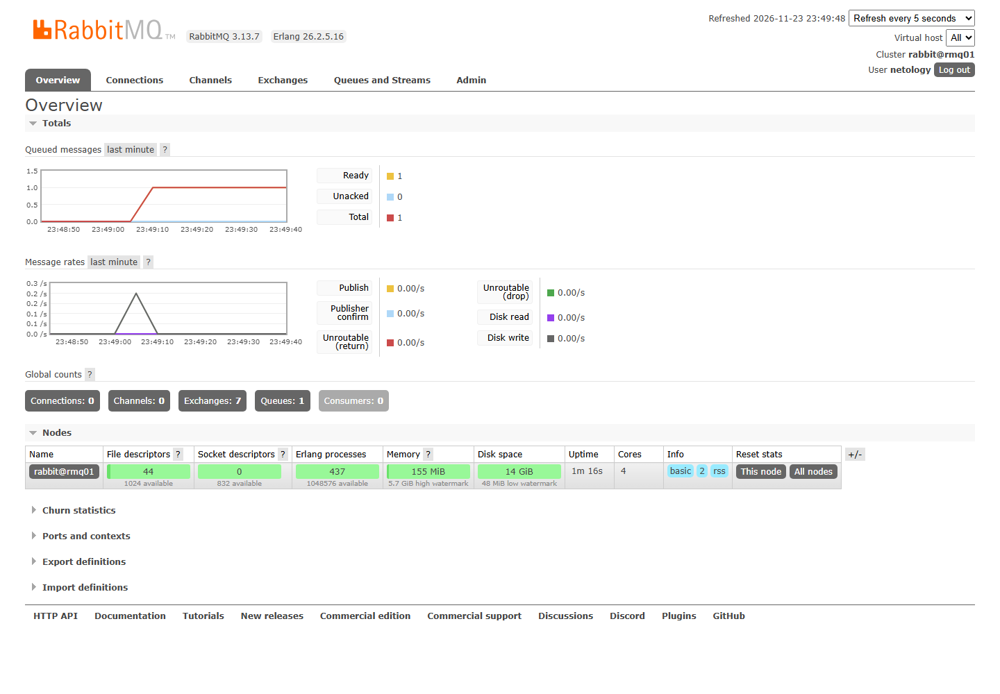
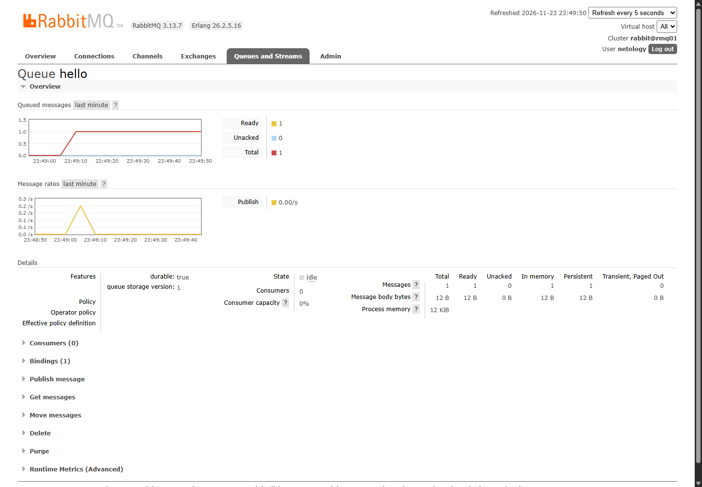
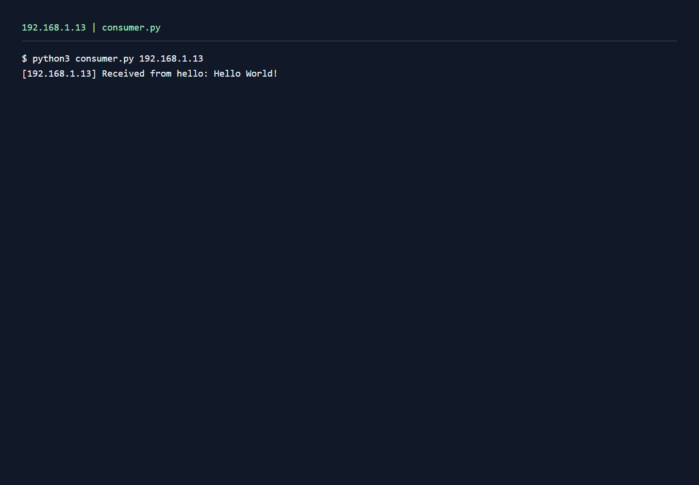
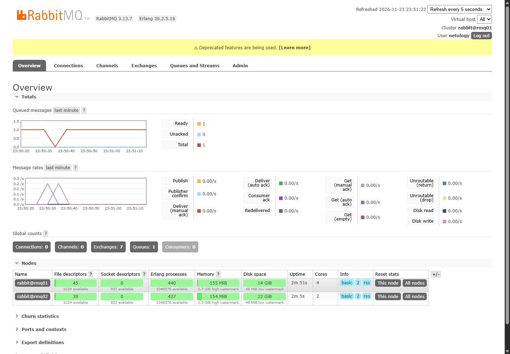
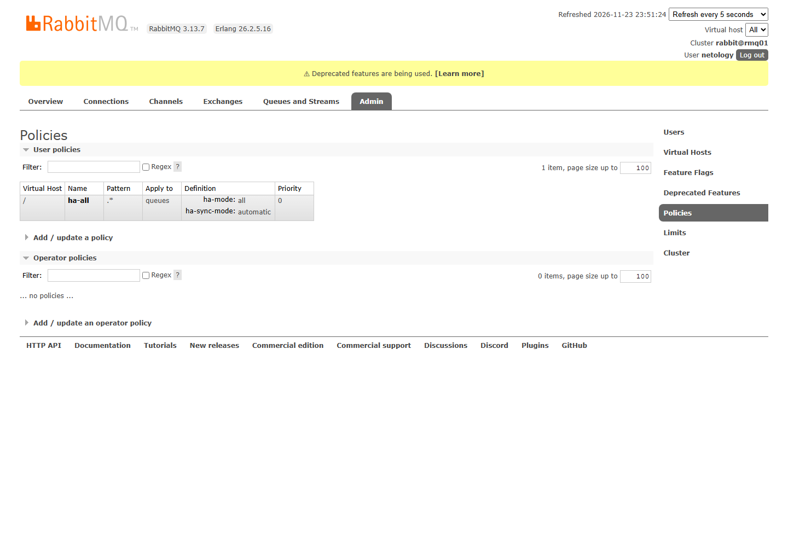
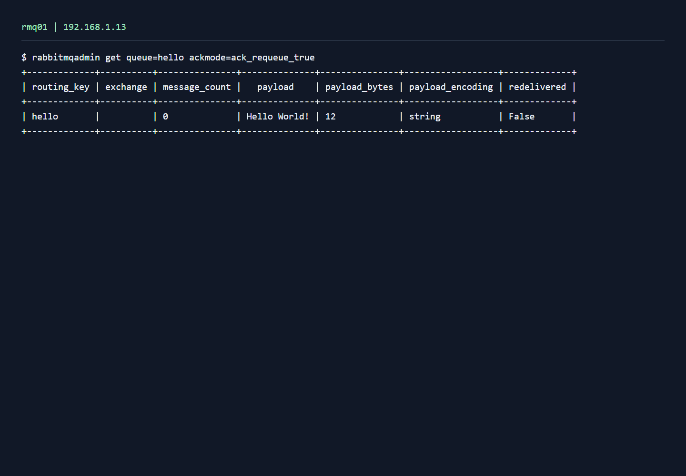
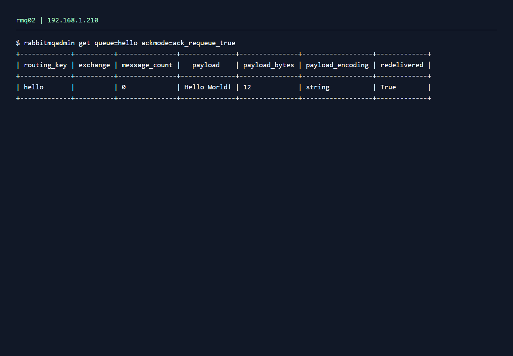
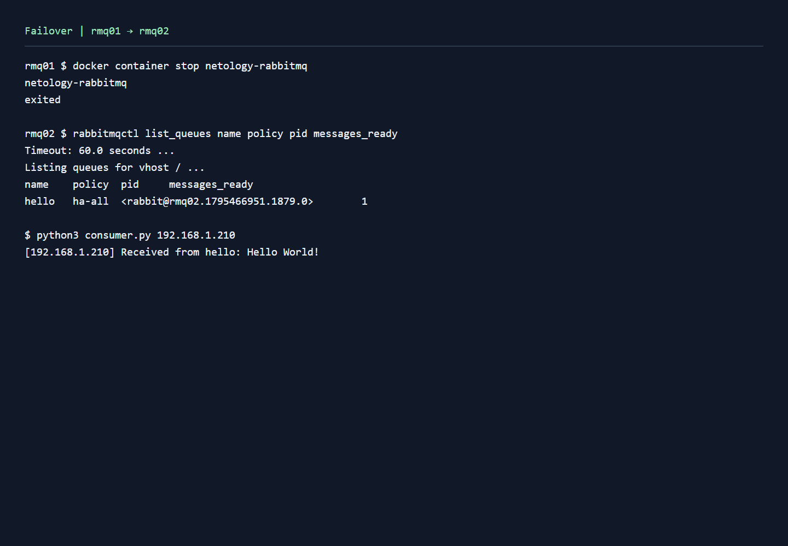

# Домашнее задание к занятию «Очереди RabbitMQ» — Чернецов Артем

## Задание 1. Установка RabbitMQ

Для лабораторной использовал две существующие виртуальные машины Ubuntu. На обеих запустил официальный Docker-образ `rabbitmq:3.13-management` (RabbitMQ 3.13.7, Erlang 26.2.5.16). Вариант `management` включает веб-интерфейс. Первая нода доступна по адресу `http://192.168.1.13:15672/`.



Для задания с политикой `ha-all` нужна поддержка зеркалирования классических очередей. Она есть в RabbitMQ 3.13 и удалена в 4.0. [Документация RabbitMQ](https://www.rabbitmq.com/docs/3.13/ha)

## Задание 2. Отправка и получение сообщений

Установил Python 3 и Pika (пакет `python3-pika` в Ubuntu). [Producer](scripts/producer.py) создал durable-очередь `hello` и отправил персистентное сообщение `Hello World!`. [Consumer](scripts/consumer.py) получил сообщение и подтвердил его обработку через `basic_ack`.

```bash
python3 scripts/producer.py 192.168.1.13
python3 scripts/consumer.py 192.168.1.13
```

Скрипты запрашивают пароль RabbitMQ или читают его из переменной окружения `RABBITMQ_PASSWORD`. Имя пользователя по умолчанию — `netology`.

Очередь `hello` после публикации, с одним сообщением в состоянии Ready.



Результат запуска consumer.



## Задание 3. Подготовка HA-кластера

В `/etc/hosts` обеих машин добавил записи и проверил `ping` в обе стороны. Контейнеры используют те же имена и общий Erlang cookie.

```text
192.168.1.13 rmq01
192.168.1.210 rmq02
```

На `rmq02` остановил приложение RabbitMQ, присоединил ноду к `rabbit@rmq01` и снова запустил приложение.

```bash
docker exec netology-rabbitmq rabbitmqctl stop_app
docker exec netology-rabbitmq rabbitmqctl join_cluster rabbit@rmq01
docker exec netology-rabbitmq rabbitmqctl start_app
```

На `rmq01` создал политику `ha-all` для всех очередей виртуального хоста `/` с автоматической синхронизацией зеркал.

```bash
docker exec netology-rabbitmq rabbitmqctl set_policy --apply-to queues \
  ha-all '.*' '{"ha-mode":"all","ha-sync-mode":"automatic"}'
```





Полный вывод `rabbitmqctl cluster_status` с [rmq01](evidence/rmq01-cluster-status.txt) и [rmq02](evidence/rmq02-cluster-status.txt). На обеих нодах вывод содержит `rabbit@rmq01` и `rabbit@rmq02` в разделе `Running Nodes`.

Повторно отправил сообщение через `rmq01`. На обеих нодах прочитал `hello` командой `rabbitmqadmin get queue=hello ackmode=ack_requeue_true`. Этот режим возвращает сообщение в очередь после чтения, поэтому оно осталось доступно для проверки отказоустойчивости.





Остановил контейнер RabbitMQ на `rmq01`. Лидером очереди стала `rabbit@rmq02` с одним готовым к доставке сообщением. Запустил `python3 scripts/consumer.py 192.168.1.210` и получил `Hello World!`. После проверки запустил контейнер на `rmq01` и убедился, что обе ноды снова работают.



## Задание 4. Ansible playbook

[Плейбук](ansible/rabbitmq.yml) разворачивает RabbitMQ Management на Ubuntu-нодах из группы `rabbitmq`, настраивает разрешение имён, объединяет ноды и применяет политику `ha-all`. Первая нода в [inventory](ansible/inventory.ini) служит начальной нодой кластера. Для добавления новых нод укажите их уникальные имена и адреса в той же группе.

Для нового кластера сгенерируйте общий Erlang cookie командой `openssl rand -hex 24`, а пароль пользователя `netology` — командой `openssl rand -hex 18`. Сохраните значения в отдельном файле Ansible Vault под именами `rabbitmq_erlang_cookie` и `rabbitmq_password`.

```bash
ansible-playbook -i ansible/inventory.ini ansible/rabbitmq.yml \
  --ask-become-pass --ask-vault-pass --extra-vars @secrets.yml
```

Для SSH-аутентификации по паролю добавьте `--ask-pass`.
